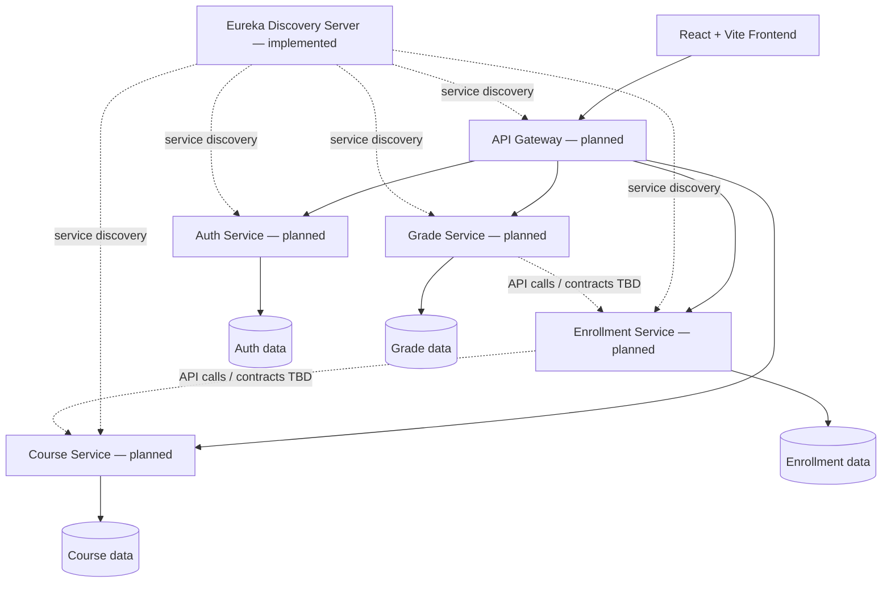

# System Architecture — University Course Registration System

**Version:** Draft 1.0  
**Date:** November 21, 2026  
**Status:** Proposed design — subject to requirements and team review

## 1. Architecture Overview

The system is planned as a web application using a **microservices architecture**. A React frontend sends requests through an API Gateway. Business capabilities are divided among independent Spring Boot services. Eureka supports service registration and discovery.

The only backend service **implemented and verified so far** is the Eureka Discovery Server. Other services and routes below are planned, not working features.

## 2. Logical Architecture



The diagram is conceptual: arrows between services do not imply implemented routes, exact API paths, or finalized synchronous call chains.

## 3. Component Responsibilities

| Component | Responsibility | Current status |
|---|---|---|
| React + Vite | Browser UI for students and administrators | Not started |
| API Gateway | Primary entry point; routes requests to services | Not started |
| Eureka Discovery Server | Registry for service discovery | Implemented and locally verified |
| Auth Service | Identity, authentication, JWT, authorization support | Not started |
| Course Service | Course catalog, course changes, and capacity | Not started |
| Enrollment Service | Student registration, drops, and enrollment rules | Not started |
| Grade Service | Grade entry, validation, and retrieval | Not started |
| PostgreSQL | Relational persistence owned by business services | Planned; schemas TBD |

## 4. Backend Repository Layout

```text
backend/
├── discovery-server/   # Implemented
├── api-gateway/        # Planned
├── auth-service/       # Planned
├── course-service/     # Planned
├── enrollment-service/ # Planned
└── grade-service/      # Planned
```

Additional project folders: `frontend/`, `docker/`, and `docs/`.

## 5. Communication Design

### 5.1 Client-to-Service
- The frontend will call the API Gateway rather than individual business services.
- The Gateway will route requests to the correct service; specific paths and route definitions are TBD.
- Authentication and authorization must be enforced at appropriate backend boundaries.

### 5.2 Service Discovery
- Eureka is used for service registration and lookup.
- The Discovery Server is configured with `spring.application.name=discovery-server` and port `8761`.
- The Discovery Server does not register with itself or fetch its own registry.
- The dashboard is accessible locally at `http://localhost:8761` when running.
- `No instances available` is expected until clients are implemented and registered.

### 5.3 Inter-Service Communication
- REST over HTTP is the planned communication mechanism.
- Spring Cloud OpenFeign and LoadBalancer may support selected synchronous service calls.
- Exact dependencies, API contracts, timeouts, retries, and failure behavior must be designed before implementation.
- No service may directly write to another service's database.

## 6. Data Ownership

The proposed database-per-service boundary is logical: each business service owns its entities and persistence schema. Physical database provisioning (separate databases versus isolated schemas) remains an implementation decision.

| Service | Candidate owned data (proposed) |
|---|---|
| Auth | Users, roles, credential metadata |
| Course | Courses, course capacity and catalog attributes |
| Enrollment | Enrollment records and enrollment status |
| Grade | Grade records linked to valid enrollments |

Cross-service references should use stable identifiers and validated APIs. Foreign keys across independently owned databases should not be assumed.

## 7. Critical Business Flows (Proposed)

### 7.1 Enrollment
1. Authenticated student submits an enrollment request through the Gateway.
2. Enrollment Service verifies authorization and applicable enrollment rules.
3. Enrollment Service checks course existence and capacity using an agreed contract with Course Service.
4. Enrollment Service prevents duplicate active enrollment and persists a valid registration.
5. Service returns confirmation or an explicit rejection reason.

**Important design risk:** Checking capacity in one service and writing enrollment in another can cause overbooking under concurrent requests. The team must decide on an atomic reservation/capacity strategy or equivalent consistency mechanism before implementing this flow.

### 7.2 Grade Entry
1. Authorized user submits a grade through the Gateway.
2. Grade Service verifies permissions, the target enrollment, and the approved grading scale.
3. Grade Service stores the result and returns a response.

Grade-entry role and grading scale are not yet approved.

## 8. Security Architecture

- Use Spring Security and JWT for protected endpoints (planned).
- Store password hashes, not plaintext passwords.
- Validate identity and authorization at backend boundaries.
- Restrict access to private student records and grade updates.
- Keep secrets out of source control; use appropriate environment-based configuration.
- Avoid logging passwords, JWTs, and sensitive student data.

## 9. Cross-Cutting Concerns

The project plans to use **Spring AOP** for at least two aspects:
- **Logging:** relevant application events and method information without secrets.
- **Execution-time measurement:** duration of selected service operations.

Additional concerns include input validation, consistent error responses, API documentation, and automated tests.

## 10. Technology Baseline

| Technology | Agreed version / choice |
|---|---|
| Java | 25 |
| Spring Boot | 4.1.3 |
| Spring Cloud | 2025.1.5 |
| Maven | 3.10.1 |
| PostgreSQL | 18.7 |
| Frontend | React + Vite |
| Service Discovery | Netflix Eureka |
| Gateway | Spring Cloud Gateway Server WebFlux (planned) |
| Build/deployment | Maven and planned Docker Compose |

These are the team baseline and intended choices; they do not imply every component has been installed, built, or integrated.

## 11. Implemented Infrastructure: Discovery Server

**Directory:** `backend/discovery-server`  
**Main class:** `com.courseregistration.discovery.DiscoveryServerApplication`  
**Application name:** `discovery-server`  
**Port:** `8761`  
**Verified:** Maven build/tests and Eureka dashboard  
**Implementation commit:** `4b8cd1f` on `development`

Run from the repository root (Windows CMD):

```cmd
cd backend\discovery-server
mvn clean verify
mvn spring-boot:run
```

If Maven uses an older JDK, configure `JAVA_HOME` and `PATH` to point to JDK 25.

## 12. Next Implementation Milestone: API Gateway

1. Initialize `backend/api-gateway` using the agreed Java/Spring versions.
2. Add Spring Cloud Gateway Server WebFlux and Eureka Discovery Client.
3. Configure the application name, port, and Eureka client settings.
4. Implement initial service routes once service contracts are defined.
5. Run tests and verify registration/interaction with Eureka.
6. Document actual configuration and update `docs/PROGRESS.md`.

Do not mark the Gateway complete before its build and runtime behavior are verified.

## 13. Architecture Decisions Requiring Approval

- Whether the application needs a distinct Instructor role.
- Exact service boundaries and API contracts.
- Enrollment capacity consistency strategy under concurrency.
- How grade records reference enrollments.
- Physical PostgreSQL isolation and migration ownership.
- Gateway authentication versus per-service authorization responsibilities.
- Timeout, retry, and error-handling policies.
- Deployment topology, service ports, and Docker Compose setup.

## 14. Related Documentation

- Root `README.md` — project overview and roadmap.
- `docs/requirements/SRS.md` — proposed requirements and business rules.
- `docs/PROGRESS.md` — verified progress and next tasks.
- `docs/DEVELOPMENT_GUIDE.md` — team setup and Git workflow.
- `docs/database/` — future ERD and schemas.
- `docs/api/` — future endpoint contracts.
- `docs/uml/` — future diagrams and OCL constraints.

---

**Approval status:** Draft. Update this document as decisions are reviewed and implemented.
